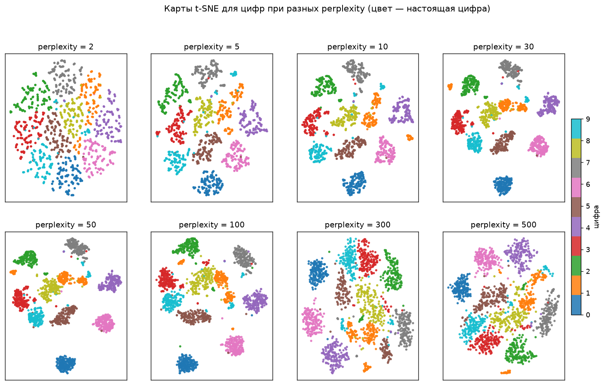
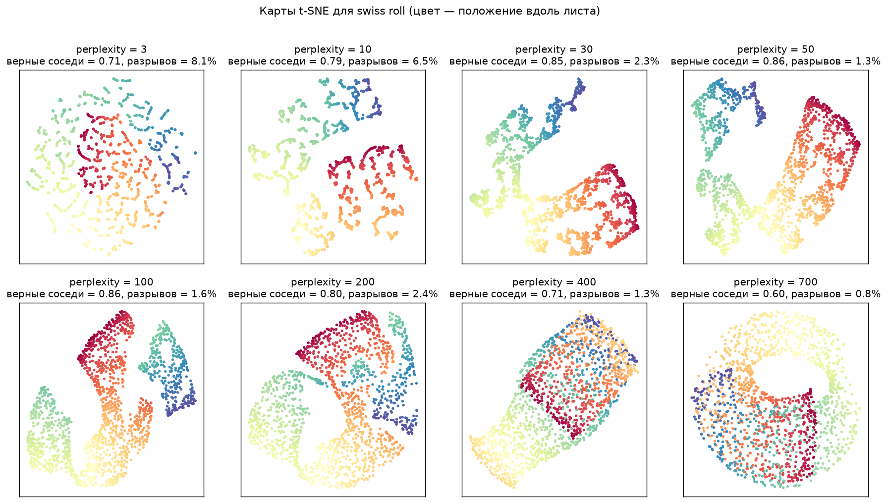

# Влияние perplexity на двумерную визуализацию t-SNE

## Постановка
Выяснить, как параметр `perplexity` меняет двумерную «карту», которую строит алгоритм t-SNE, и какие значения разумно использовать.

## Краткое описание решения
Вся работа — в ноутбуке `src/solution.ipynb`. Меняется только `perplexity`, остальные настройки `sklearn.manifold.TSNE` фиксированы (`init='pca'`, `learning_rate='auto'`, `max_iter=1000`, `random_state=65`), поэтому результат повторяется при каждом запуске.

1. **Введение.** Что такое t-SNE и perplexity простыми словами; как правильно (и неправильно) читать картинки t-SNE.
2. **Эксперимент 1 — рукописные цифры.** Карты для perplexity 2, 5, 10, 30, 50, 100, 300, 500. Качество оценивается двумя простыми метриками и сравнивается с контрольными вариантами (случайные точки и обычная проекция PCA).
3. **Эксперимент 2 — swiss roll.** Плоский лист, свёрнутый в рулон: t-SNE должен «развернуть» его. Perplexity 3…700; показано, где и почему лист разрывается.
4. **Выводы** и ограничения работы.

**Метрики:**
- *Верные соседи* — для каждой точки доля её 10 ближайших соседей на карте, совпавших с 10 ближайшими соседями в исходных данных.
- *Чистота* (только для цифр) — доля точек, у которых большинство из 5 ближайших соседей на карте имеет ту же цифру.
- *Доля разрывов* (только для swiss roll) — доля пар соседей из исходных данных, оказавшихся на карте в 4 раза дальше обычного расстояния между соседями.

## Используемые данные
- `sklearn.datasets.load_digits` — 1797 изображений 8×8 (64 признака), 10 классов (цифры 0–9). Встроенный набор, интернет не нужен.
- `sklearn.datasets.make_swiss_roll` — синтетический «свёрнутый лист», 1500 точек, шум 0.05, `random_state=65` (сид задаёт саму выборку точек: при другом сиде картины при больших perplexity заметно отличаются).

## Полученные результаты



**Цифры** (контроль: у PCA — верные соседи 0.1, чистота 0.6; у случайных точек — 0.0 и 0.1):

| perplexity | доля верных соседей | чистота | 
|---:|---:|---:|
| 2   | 0.491 | 0.987 | 
| 5   | 0.544 | 0.989 |
| 10  | 0.574 | 0.990 | 
| 30  | 0.585 | 0.989 |
| 50  | 0.576 | 0.988 |
| 100 | 0.541 | 0.983 | 
| 300 | 0.471 | 0.973 | 
| 500 | 0.421 | 0.962 | 


- Малые значения (2–5): карта «рассыпается», группы дробятся на мелкие кусочки.
- Средние (10–50): чёткие компактные кластеры, максимум «верных соседей». Различия внутри диапазона малы и по одному запуску значимыми не считаются.
- Большие (300–500): кластеры расплываются и склеиваются.
- «Чистота» почти не меняется, то есть она слишком грубая, чтобы заметить расплывание кластеров.

**Swiss roll** (`src/results_swiss_roll.csv`):

| perplexity | 3 | 10 | 30 | 50 | 100 | 200 | 400 | 700 |
|---|---:|---:|---:|---:|---:|---:|---:|---:|
| верные соседи | 0.71 | 0.79 | 0.85 | 0.86 | 0.86 | 0.80 | 0.71 | 0.60 |
| доля разрывов | 8.1 % | 6.5 % | 2.3 % | 1.3 % | 1.6 % | 2.4 % | 1.3 % | 0.8 % |



- Малое perplexity (3–10) рвёт лист на «нити»; при 30–100 лист в основном развёрнут, но изогнут (30) или разорван на крупные части (50–100); при 400 слои рулона перемешиваются; при 700 карта превращается в кольцо с перемешанными слоями.
- Идеальной полосы t-SNE не даёт нигде: он сохраняет соседей, но может «разрезать» лист. Пустые промежутки между кусками — следствие разреза, а не свойство данных (рисунок `src/figures/06_swiss_roll_breaks.png`: при perplexity 50 основной пучок разорванных пар идёт через промежуток между светло-зелёной и бирюзовой частями листа).

**Общий вывод.** Разумная середина — примерно 10–50 (типичное стартовое значение ≈ 30) для данных такого размера; надо смотреть несколько значений и не интерпретировать размеры групп, расстояния между далёкими группами и пустые промежутки.

**Ограничения:** два набора данных, один расчёт на значение; зависимость результата от стартовой раскладки; грубоватые метрики.

## Структура проекта
```
├── README.md
├── requirements.txt
└── src/
    ├── solution.ipynb          # код, графики, пояснения и выводы (с сохранёнными результатами запуска)
    ├── results_digits.csv      # метрики эксперимента 1
    ├── results_swiss_roll.csv  # метрики эксперимента 2
    └── figures/                # графики, сохраняемые ноутбуком
```

## Инструкция по запуску
Нужен Python 3.9+ (проверено на 3.12, scikit-learn 1.8).

```bash
python -m venv .venv
source .venv/bin/activate          # Windows: .venv\Scripts\activate
pip install -r requirements.txt

cd src
jupyter notebook solution.ipynb    # затем Run All
```

Ноутбук нужно запускать из каталога `src/` — графики и таблицы сохраняются рядом с ним. 